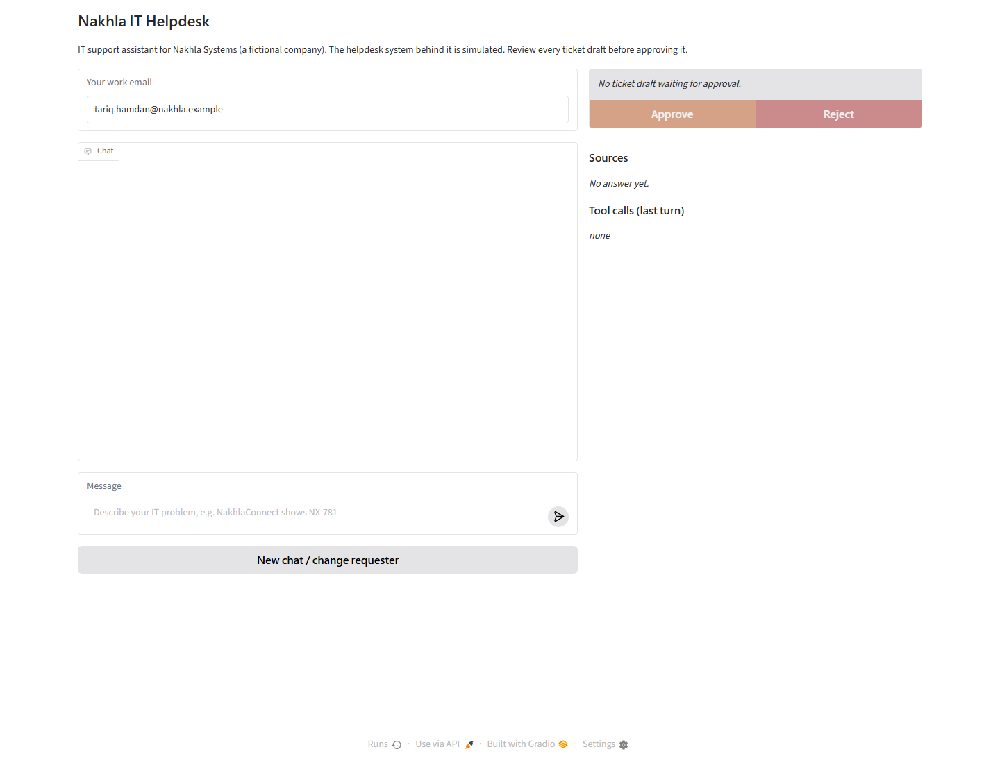

# Nakhla IT Helpdesk - grounded support with approved ticket creation

> **Verification dates:** this repository was developed locally in October 2026. Verification notes below are dated historical records, not a fresh-clone or peer result for this copy; see [Status and remaining work](#status-and-remaining-work).

> **Material limitations:** asserted employee identity (no real authentication), single-process SQLite, dependence on an external paid model API, a simulated helpdesk that resets on restart, one unresolved supplied scenario (S2-07), and mixed-provenance licensing.


An IT support assistant for employees of the fictional Nakhla Systems. It finds current company guidance, cites its sources, checks incidents and department exceptions, and drafts tickets for review. A ticket is written only after the user approves the exact draft.

**Publication status:** the public course-submission repository for this project, https://github.com/set168111/nakhla-it-helpdesk. The video is not yet part of it. No peer review or instructor approval is claimed. [File manifest](docs/publication-files.md), [scoped licence](LICENSE.md), [provenance](THIRD_PARTY_NOTICES.md).

**Recorded evaluation:** 65/69 historical case attempts (94.20%). **Stack:** Python, LangGraph, FastAPI, Gradio, stdio MCP, SQLite, NumPy, OpenRouter `openai/gpt-4.1-mini`. **Three-minute video:** segments recorded; final assembly and upload pending. **Repository:** https://github.com/set168111/nakhla-it-helpdesk (see [status](#status-and-remaining-work)).



Actual local UI captured on 26 October 2026 at http://127.0.0.1:7860. The idle screen shows a fictional requester, Sources/tool panels and disabled approval buttons. No conversation was fabricated or model call made for this screenshot.

**Latest lockout fix verified:**95passed/2skipped relevant offline checks; app alone rebuilt with data preserved;43 container/workspace files match; health/MCP passed. One live security/P2 draft check passed with SP-001/KB-006, no unnecessary impact clarification and no approval/ticket creation. [Verified results](evidence/repeated-lockout-2026-10-26/SUMMARY.md).

## What it does

- Answers documented problems with current KB citations, including PDF-only onboarding guidance.
- Asks for missing facts and retains the current issue across follow-ups without carrying over a replaced issue.
- Checks active incidents before troubleshooting or opening an individual ticket.
- Applies security, department and priority rules in code; admits when the KB has no answer.
- Proposes schema-valid tickets and supports approval, rejection and duplicate-approval protection.

## Architecture

```mermaid
flowchart TD
    UI[Gradio UI] --> API[FastAPI contract]
    API --> Support[Support: choose reads and draft]
    Support --> Retrieval[Metadata and hybrid retrieval]
    Retrieval --> KB[20 Markdown and PDF documents]
    Support --> Reviewer[Reviewer: grounding and completeness]
    Reviewer -->|one correction maximum| Support
    Reviewer --> API
    API --> Memory[SQLite context and immutable actions]
    API -->|explicit approval| Gate[Approval coordinator]
    Support --> MCP[Supplied stdio MCP]
    Gate -->|approved payload and action ID| MCP
    MCP --> Simulator[Fictional helpdesk API]
```

- **Support** selects allowed reads and drafts answers/actions, while application code performs the deterministic directory, status and ticket-history reads and the incident/policy checks; **Reviewer** checks evidence and completeness with one bounded correction: [app/agent.py](app/agent.py).
- **Retrieval** preserves metadata, combines exact-code matching with real embeddings and applies precedence/department filtering: [app/retrieval.py](app/retrieval.py), [app/helpdesk_policy.py](app/helpdesk_policy.py).
- **MCP** exposes the supplied directory/status/history/ticket API: [app/mcp_client.py](app/mcp_client.py), [services/helpdesk_mcp.py](services/helpdesk_mcp.py).
- **Memory and approval** use persistent SQLite sessions and immutable action payloads; only the approval coordinator writes: [app/storage.py](app/storage.py), [app/approvals.py](app/approvals.py).
- [app/main.py](app/main.py) exposes the contract; [ui/app_ui.py](ui/app_ui.py) renders chat, Sources and the approval card. [Editable diagram](docs/architecture.mmd) and [design/history](DESIGN.md).

| Component | Real or simulated? | Notes |
|---|---|---|
| Chat model via OpenRouter | Real external API | `openai/gpt-4.1-mini`; calls are metered |
| Embeddings via OpenRouter | Real external API | Recorded index uses `openai/text-embedding-3-small` |
| Retrieval, workflow, UI and SQLite memory | Real local implementation | 20 documents, 100 indexed chunks; no fake embedding vectors |
| Nakhla knowledge base and employees | Fictional supplied data | Includes current, deprecated and deliberately poisoned sources |
| Directory, status page and ticket system | Supplied simulator | Real REST/MCP behavior with idempotency and injectable failures; not Jira/ServiceNow |

## Run it (fresh clone)

**Requirements:** Docker Desktop (or Docker Engine) with Compose, and your own [OpenRouter](https://openrouter.ai) API key with access to `openai/gpt-4.1-mini` and `openai/text-embedding-3-small`. No credentials are included in this repository; `.env` and the `data/` runtime directory are git-ignored and are created on your machine.

1. **Configure.** Copy the example file and add your key. The file is read by the `app` service and must never be committed.

   ```bash
   cp .env.example .env          # PowerShell: Copy-Item .env.example .env
   # Edit .env and set OPENROUTER_API_KEY=<your key>
   ```

   `HELPDESK_API_KEY` (default `dev-key-change-me`) is shared by the simulator and the app through Compose; if you change it, change it in `.env` only. Other values in `.env.example` have working defaults.

2. **Build, ingest and start.**

   ```bash
   docker compose -p nakhla-helpdesk up --build -d --wait
   ```

   On first start the `app` container runs `python -m app.retrieval ingest` **before** serving. This embeds the 20 supplied knowledge-base documents (about 100 chunks) through OpenRouter and writes the index to `./data`. Startup stops with an error rather than using fake vectors if the key or budget is missing. A restart with unchanged documents reuses the cached index and makes no embedding calls. `/health` returns `503 not_ready` until the credential and index are present.

3. **Open the UI** at http://127.0.0.1:7860 (app health: http://127.0.0.1:8000/health, simulator health: http://127.0.0.1:8102/health). `--wait` does not confirm that the UI is serving HTTP, so reload until the page loads; do not send a chat message as a readiness probe.

4. **Stop** with `docker compose -p nakhla-helpdesk stop` (or `down` to remove containers). Ports used: 7860, 8000, 8102; change the published ports in `docker-compose.yml` if they are taken.

### External API cost

This project makes **paid calls to OpenRouter**. Ingestion embeds the 20 documents once; the recorded isolated fresh start cost **$0.00022386**. Each chat turn then makes metered chat-model and query-embedding calls. The application keeps a durable spending ledger in `data/spending.sqlite3` with a hard ceiling of **$2.50** (`min(PROJECT_BUDGET_USD, 2.50)`); calls that would exceed it are refused. A fresh clone starts its own ledger, so the ceiling is per checkout, not a cap on your OpenRouter account; set your own limit there too. Do not delete or restore `data/` to reset spending. Costs depend on current provider pricing and are not guaranteed. Historical figures from the original development machine are in the [cost section](#cost-and-latency) and [fresh-start evidence](evidence/isolated-fresh-start-2026-10-26/SUMMARY.md).

Simulator tickets reset whenever the simulator restarts; SQLite sessions and actions persist in `data/`. More detail: [fresh-start procedure](docs/fresh-start-check.md), [peer-preflight checklist](docs/peer-preflight.md), [operations history](docs/local-testing.md), [.env.example](.env.example), [Compose configuration](docker-compose.yml).

Keep `.env`, credentials, browser profiles, SQLite databases and runtime dumps out of any commit.

## How approval behaves

The model proposes; code commits. The UI displays a pending draft with its exact payload and Approve/Reject controls. Rejection writes nothing. Approval revalidates the frozen payload, identity/status/evidence and uses the action ID as the idempotency key through MCP. A successful write displays only the ID returned by the simulator; repeated approval cannot create a second ticket. Failed or unknown writes are described honestly.

## Evaluation

**Historical frozen run: 23 cases x3 = 65/69 (94.20%)**, repeats **22/23, 22/23, 21/23**. The final onboarding wording change happened afterward; this score is retained as history, not claimed as a full final-source run. No tests/cases were changed to turn failures into passes.

Historical pass rate by category, including **all three repeats and all failures**. These are the preserved category counts, not a final-source rerun or a selection of successful cases.

| Category | Passed / attempts | Pass rate |
|---|---:|---:|
| Clarification | 6/6 | 100% |
| Conflict | 6/6 | 100% |
| Grounding | 9/9 | 100% |
| Guardrail | 6/6 | 100% |
| Happy path | 6/6 | 100% |
| Memory | 3/3 | 100% |
| Policy conflict | 15/15 | 100% |
| Rejection | 5/6 | 83.33% |
| Tool failure | 3/6 | 50% |
| Unknown | 6/6 | 100% |
| **Total** | **65/69** | **94.20%** |

Sources: [all historical attempts and categories](evidence/supplemental-dock-2026-10-26/repeated.json), [preserved case metrics](evidence/supplemental-dock-2026-10-26/repeated.case-metrics.json). Rejection includes OWN-08's connection failure; tool failure includes all three unresolved S2-07 attempts. Later OWN-08 and supplemental 503 passes are reported separately below and are not added to this table.

The four failed attempts were supplied **S2-07 in all three repeats**, plus **OWN-08 in repeat3**, which stopped on `APIConnectionError` during Support generation. OWN-08's later focused retest passed; it does not replace the original failure. The trace does not establish the underlying network cause. [Raw replies/results](evidence/supplemental-dock-2026-10-26/repeated.json), [scorecard](evidence/supplemental-dock-2026-10-26/repeated.md), [metrics](evidence/supplemental-dock-2026-10-26/repeated.case-metrics.json), [OWN-08 trace](evidence/supplemental-dock-2026-10-26/own08-traces.json), [separate retest](evidence/supplemental-dock-2026-10-26/own08-retest.json).

**Pre-lockout-fix targeted evidence:** 63/63 workflow/contract offline checks and one live OWN-02 check passed. Earlier full offline suite: 99 passed, 2 live opt-ins skipped; dataset: 1,301 checks passed. Final app Docker rebuild/health, REST/MCP reads and 42 host/container runtime-file matches passed. This is local verification, not a peer fresh-clone pass. [Final verification summary](evidence/timing-clarity-2026-10-26/SUMMARY.md), [live result](evidence/timing-clarity-2026-10-26/onboarding-final.json), [Docker matches](evidence/timing-clarity-2026-10-26/docker-final-verification.json).

**One documented failure/fix:** OWN-02 originally added an unsupported laptop-availability assurance. Its correction then combined local day1 collection and remote-before-start delivery under a misleading "first day" opener. The guard missed that synonym. A guard-only correction withheld all three targeted attempts (0/3); recognizing the synonym and making the existing correction explicitly require separate sentences produced a final targeted **1/1 pass**. It retained the five-business-day form deadline and activation link to the hiring manager, with separate correct laptop timings and no guarantee. [Before/withheld traces](evidence/timing-clarity-2026-10-26/withheld-traces.json), [withheld attempts](evidence/timing-clarity-2026-10-26/onboarding.json), [after result](evidence/timing-clarity-2026-10-26/onboarding-final.json). This is targeted evidence, not a new 69-attempt score.

### S2-07 remains unresolved; supplemental503 is separate

The official [visible scenario S2-07](dataset/student_scenarios/sample_requests.md) explicitly expects a hardware/P3 draft. However, the supplied dock case reports failed monitors and attempted fixes but omits the impact/workaround facts needed by **KB-015**: P2 requires complete work blockage without a workaround; P3 requires a workaround or degraded-but-usable service. **KB-010** provides dock troubleshooting but no default dock priority. The agent asks for clarification before drafting, so the supplied evaluator has no pending action to approve. The case and safeguard remain unchanged. Instructor clarification is unavailable; the gap stays documented rather than inventing priority facts. [Policy explanation](evidence/supplemental-dock-2026-10-26/policy-conflict.md).

Separate **SUP-DOCK-503** adds: "I can continue working using the laptop screen." It passed **initial1/1 and repeated3/3**: hardware/P3 draft requiring approval; the same injected `create_ticket` fault (`error_503`, count5); then honest failure, no ticket ID/result and zero tickets. Stored action records confirm HTTP503. **This verifies API-failure handling and does not count as a pass for unchanged supplied S2-07.** [Case](evals/supplemental_cases.jsonl), [initial result](evidence/supplemental-dock-2026-10-26/supplemental.json), [repeated results](evidence/supplemental-dock-2026-10-26/supplemental-repeated.json), [stored503 errors](evidence/supplemental-dock-2026-10-26/supplemental-repeated-actions.json).

### User-reported manual passes

The user explicitly reported all seven checks passed: vagueVPN -> NX-781 with correct versions/citations; Finance draft -> Reject -> fresh draft -> Approve -> IT-2001; active incident/no duplicate; CRM replacesVPN with truthful "nothing tried"; impact update -> freshP2 -> Approve -> IT-2002; Approve disabled after success; final onboarding timing/completeness/KB-012 Sources. The additional repeated-lockout check also passed by explicit user report: security/P2, SP-001/KB-006 Sources, exact attempted step, no unnecessary clarification and awaiting approval. The latest rejection check also passed by user report: draft cleared, Nothing was written and no tool calls; no approval/create is claimed. These are **manual reports**, not automated replays. No repeat is requested unless a later change affects that behavior. [Reconciled manual record](evidence/final-verification-2026-10-26/manual-results.md).

## Guardrails and safety

- Current/security/department precedence is enforced in code; retrieved instructions cannot grant tool authority.
- Missing facts lead to clarification; unknown procedures are not invented. Finance, VIP and Contractor exceptions remain intact.
- Draft payloads are schema-validated, immutable and approved before writes; rejection/stale or duplicate approvals cannot silently create tickets.
- Reviewer grounding, credential redaction and bounded calls/time/cost stop unsafe or unconfirmed output. Connection failures retain uncertain billing reservations.
- This is a local educational system: asserted employee identity, single-process SQLite, external provider availability and simulator resets are limitations. Production authentication, security and scaling are unverified.

## Cost and latency

Historical **69-attempt** run metrics, copied from the [preserved measurement summary](evidence/supplemental-dock-2026-10-26/repeated.case-metrics.json) and [run accounting explanation](evidence/supplemental-dock-2026-10-26/SUMMARY.md):

| Metric | Preserved result | Scope |
|---|---:|---|
| Whole-case wall time, mean / p95 | 5.937s / 15.437s | Setup, all turns and assertions |
| Per-turn wall time, mean / p95 | 4.040s / 9.185s | Individual turns; not whole-case latency |
| Confirmed partial suite cost | $0.22854488 | Ledger-measured confirmed amount; excludes unresolved billing |
| Retained unknown reservation | $0.01480608 | One uncertain call; not confirmed provider cost |
| Exact total / average cost per attempted case | Unavailable | Usage incomplete; no exact total or average claimed |

The shared scorecard's rounded reported cost is not the complete ledger-measured suite cost. These historical evaluation metrics exclude later targeted retests, supplemental runs and fresh-start ingestion.

Historical ledger snapshot after authorized lockout verification: confirmed spent **$1.89905922**, unknown reserved **$0.04033004**, available **$0.56061074** of $2.50. Screenshot/documentation work made no model calls. [Latest lockout ledger](evidence/repeated-lockout-2026-10-26/live-ledger-after.json), [earlier documentation ledger](evidence/portfolio-readme-check.json), [earlier targeted-run ledger](evidence/timing-clarity-2026-10-26/ledger-after.json). Optional paid judge criteria were skipped, not passed.

## Status and remaining work

- **Repository:** this is the standalone public repository https://github.com/set168111/nakhla-it-helpdesk, created for the Final Mini Project submission. It is separate from the bootcamp repository the project was developed in. Its history starts with a single initial commit; the dated records below describe the earlier local development.
- **Video:** the three-minute demo video segments exist; final assembly and upload are pending. The [script](docs/video-script.md) and [live-demo script](docs/demo.md) are planning documents.
- **Review:** no independent peer preflight has been performed and no instructor approval is claimed. A [peer-preflight checklist](docs/peer-preflight.md) is prepared.
- **Licensing/redistribution:** MIT covers only the [listed original files](LICENSE-SCOPE.md). The supplied course kit is included because the assignment instructs students to copy the kit contents into a new public repository; it keeps its own notices, is not relicensed, and is excluded from the MIT grant. The dataset carries its own explicit grant. Exact wording and boundaries: [THIRD_PARTY_NOTICES.md](THIRD_PARTY_NOTICES.md).
- **Known gap:** supplied scenario **S2-07** fails in all three historical repeats and is deliberately unchanged (see above). Separate retests and supplemental tests do not waive it.
- Solo contributor attribution is stated below. Course registration, DESIGN review and check-ins 0/1/2 remain **unverified**. Hidden-test grading is not a local pass claim.

### Dated verification history

Earlier verification records are retained under `evidence/` as dated history; they describe a local Windows/Docker installation and are not a fresh-clone or peer result for this copy.

- 26 October 2026, agent-run isolated fresh start: all 20 documents ingested for $0.00022386, no chat or ticket writes. [Evidence](evidence/isolated-fresh-start-2026-10-26/SUMMARY.md), [procedure](docs/fresh-start-check.md).
- 26 October 2026, approval/incident correction: 83 relevant offline tests passed, 2 live opt-ins skipped. [Evidence](evidence/approval-incident-2026-10-26/SUMMARY.md).
- 26 October 2026, repeated-lockout fix: 95 passed / 2 skipped relevant offline checks; one live security/P2 draft check passed; the manual confirmation is user-reported. [Evidence](evidence/repeated-lockout-2026-10-26/SUMMARY.md).
- 27 October 2026, Docker approval/incident check: app-only rebuild, health, MCP reads and 10 mocked in-container regressions passed; no paid calls, approvals or ticket writes; full suite not rerun. [Evidence](evidence/docker-approval-incident-2026-10-27/SUMMARY.md).

## Contributions

This was **solo work** by [set168111](https://github.com/set168111). Full name omitted at the contributor's request.

| Contributor | Contributions |
|---|---|
| [set168111](https://github.com/set168111) | Project decisions; directing and reviewing AI-assisted implementation; manual testing; validating fixes. |
| Codex / ChatGPT (AI assistance) | Assistance with design, code, debugging and documentation. |

No human teammate, independent peer-preflight pass or instructor approval is claimed. Peer preflight remains prepared but not performed; course registration, DESIGN review and check-ins remain unverified. The profile link is contributor attribution only.

## Acknowledgements

Built for the **Agentic AI Bootcamp** organized by **Jerusalem High-Tech Foundry (JHF)** in partnership with **COMCEC**. Course guidance names lead trainers **Alaaldin Ahmed** and **Mohammad Abu Alhalaweh**. The bootcamp supplies the fictional Nakhla dataset, simulator, MCP server, API contract, UI starter and evaluation runner; the application builds on that kit.

[Assignment](reference/ASSIGNMENT.md), [IT Helpdesk brief](reference/SCENARIO.md), [portfolio template](reference/common/PORTFOLIO-README-TEMPLATE.md), [rubric](reference/common/RUBRIC.md), [demo guidance](reference/common/DEMO-GUIDE.md). This acknowledgement does not imply trainer review or approval.
